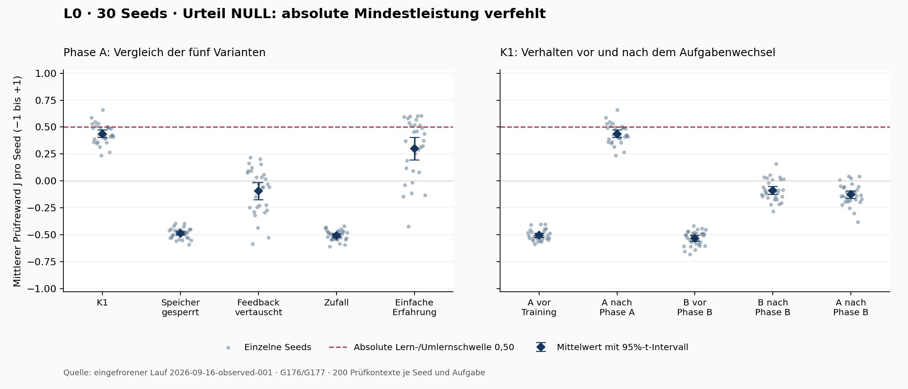

# L0 / G176–G177 — Abschluss des ersten kontrollierten Laufs

Michael Kupermann · 16.09.2026

## Urteil und Entscheidung

**NULL nach dem vorab festgelegten Vertrag.** K1 zeigt eine deutliche,
feedbackabhängige Verbesserung bei neuen Eingaben, verfehlt aber die geforderte
absolute Mindestleistung. Der Aufgabenwechsel verfehlt sowohl das Umlern- als
auch das Behalten-Kriterium. Ich schließe diesen Kandidatenlauf ohne Nachjustieren
der Schwellen oder automatische Wiederholung ab.

Das Ergebnis ist ein belastbarer Teilbefund über diese einfache Aufgabe. Es ist
kein Nachweis für allgemeines Lernen, eigene Zielbildung oder neue Mathematik.



## Phase A: Was wurde erreicht?

J ist der mittlere Prüfreward zwischen −1 und +1. Er ist keine Erfolgsquote.
Alle Angaben beruhen auf 30 Seeds und jeweils 200 zurückgehaltenen Prüfkontexten.
Die Standardabweichung beschreibt die Streuung der Seed-Mittelwerte.

| Variante | Mittelwert J | Standardabweichung |
|---|---:|---:|
| K1 vollständig | 0,4374 | 0,0922 |
| Gleicher Kern, Speicherung gesperrt | −0,4881 | 0,0486 |
| K1, Feedback vertauscht | −0,0946 | 0,2147 |
| Gleichverteilte Zufallshandlung | −0,5082 | 0,0475 |
| Einfache positive Erfahrungsreferenz | 0,2991 | 0,2793 |

K1 liegt **0,0626 unter der absoluten Schwelle von 0,5000**. Sein ergänzend
dargestelltes 95%-t-Intervall für den Mittelwert liegt ungefähr bei [0,403; 0,472].
Das vorgeschriebene PASS-LERNEN ist deshalb nicht erreicht.

Die übrigen Phase-A-Kriterien sind erfüllt:

- Gegen gesperrte Speicherung: gepaarter Vorteil **0,9255**, 95%-Intervall
  **[0,8849; 0,9661]**; gefordert waren mindestens 0,10 und eine positive Untergrenze.
- Gegen vertauschtes Feedback: Vorteil **0,5321**, Intervall **[0,4518; 0,6124]**.
- Beide Kontrollarme bleiben unter der absoluten 0,50-Schwelle.
- Der separat registrierte Vorteil gegenüber der einfachen Erfahrungsreferenz
  ist erfüllt: **0,1383**, Intervall **[0,0321; 0,2445]**; Schwelle 0,05.

Das NULL bedeutet hier **Mindestanforderung verfehlt**, nicht „keinerlei Wirkung“.
Der Anfangswert von K1 war −0,5063; die beobachtete Verbesserung und die
Kontrollkontraste sprechen innerhalb dieser Aufgabe für wirksame Erfahrungsverarbeitung.

## Aufgabenwechsel: Was gelingt noch nicht?

Vor Phase B beträgt K1s Leistung auf B −0,5345; nach 1200 B-Versuchen −0,0884.
Die Verbesserung von **0,4461** erfüllt die geforderte Verbesserung von 0,10,
aber die absolute B-Schwelle von 0,50 wird deutlich verfehlt. **UMLERNEN: nein.**

Auf der alten Aufgabe A sinkt K1 gleichzeitig von 0,4374 auf −0,1285.
Der Verlust von **0,5660** überschreitet die erlaubten 0,10. **BEHALTEN: nein.**
Der alte A-Zustand bleibt als gespeicherter, exakt wiederherstellbarer Checkpoint
erhalten; „Behalten“ bezeichnet hier das Verhalten des weitertrainierten Zustands.

A und B verlangen bei demselben Eingang überwiegend widersprüchliche Handlungen.
Ein Aufgabenindikator fehlt absichtlich. Gleichzeitiger Erfolg war daher nicht
vorausgesetzt. Plausibel ist Interferenz zwischen alten und neuen Erfahrungen;
dieser Mechanismus wurde durch diesen Lauf allein nicht isoliert nachgewiesen.

## Gegenprüfung und Aussagegrenzen

- **Baseline plausibel:** Die uniforme Referenz liegt nahe dem analytisch aus
  dem Bewertungsdreieck ableitbaren Erwartungswert von rund −0,5006. Sie ist
  nicht künstlich unter Zufallsniveau gedrückt.
- **Kausale Kontrolle:** Passend zugeordnetes Feedback ist deutlich besser als
  vertauschtes. Dessen eigene Verbesserung gegenüber Zufall wird offengelegt;
  er bleibt unter der geforderten absoluten Schwelle.
- **Vergleich begrenzt:** Die einfache Erfahrungsreferenz ist übertroffen.
  Ein starker etablierter kontinuierlicher Bandit-/Regressionsansatz wurde nicht
  getestet. Eine Überlegenheit gegenüber dem Forschungsstand ist damit offen.
- **Budgets:** Kontexte, Feedbackanzahl und Phasenbudgets sind identisch. Die
  unterschiedlichen Methoden haben keine identische Rechenzeit; dies ist ein
  Vergleich bei gleicher Interaktionserfahrung, kein Effizienzbenchmark.
- **Statistik:** Gepaarte zweiseitige 95%-t-Intervalle über 30 Seeds, keine
  Auswahl erfolgreicher Seeds. Keine zusätzliche Korrektur für mehrere Vergleiche;
  die Baseline-Aussage bleibt auf den registrierten separaten Vergleich beschränkt.
- **Reproduzierbarkeit:** Alle 30 Wiederholungen wurden im gleichen eingefrorenen
  Umfeld exakt reproduziert. Das ist keine unabhängige Replikation auf einer
  anderen Maschine oder einer anderen Aufgabe.
- **Unabhängige Nachrechnung:** 360.000 ursprüngliche Trainingsereignisse und
  180.000 Prüfhandlungen wurden ohne Import des Lernkerns/Prüfers auf Bewertung,
  Feedback-Zuordnung, Splits und Statistik geprüft. Toleranz 1e−12; bestanden.

Unsicherheit des Urteils innerhalb des Vertrags: **niedrig**. Erklärung der
Interferenz: **mittel**. Übertragbarkeit auf offene Wahrnehmung, eigene Ziele
und mathematische Neuheit: **hoch** beziehungsweise nicht nachgewiesen.

## Reproduktion und Ressourcen

- [Unveränderter Messvertrag G176](../amendments/G176_l0_continuous_experience_learning.md)
  und [Ausführungsvertrag G177](../amendments/G177_l0_frozen_run.md).
- [Manifest mit Code-/Protokoll-/Umgebungshashes](../../archive/run-logs/l0/2026-09-16-observed-001/manifest.json).
  Das Manifest identifiziert den lokalen Codezustand; es wurde kein neuer Commit erstellt.
- [Vollständiges Ergebnis mit allen Seed-Werten und Artefakthashes](../../archive/run-logs/l0/2026-09-16-observed-001/result.json).
- [Unabhängiger Auditnachweis](../validation/l0-20260916-independent-audit.json),
  [150 Seed-/Variantenzeilen als CSV](../validation/l0-20260916-seed-scores.csv),
  [Grafik als SVG](../validation/l0-20260916-results.svg).
- Windows, CPU, vorhandene Python-3.13-Umgebung; genaue Python-/NumPy-Versionen
  im Manifest. PCG64, Master-Seeds 0–29; benannte Zufallsströme unverändert.
- Lauf einschließlich exakter Reproduktion: **403,747 Sekunden / 6:44 Minuten**.
  Maximaler residenter Prozessspeicher **358,98 MiB**. Grenzen 7140 Sekunden und
  2048 MiB eingehalten. Die frühere Einzelkern-Messung war keine Prognose des
  Speicherbedarfs des vollständigen Artefakt- und Reproduktionsablaufs.
- Vor Start bestanden **57 technische Tests**; Sicherheitsprüfung von 260
  Testmodulen ohne unklassifizierte Gefahren. Launcher innerhalb seines neuen
  60-Minuten-Budgets erstellt; der frühere Budgetfehler bleibt im Logbook erhalten.

Nur lesend nachprüfen:

```powershell
.\.venv\Scripts\python.exe -B -m vibrasim2.l0.run assess archive/run-logs/l0/2026-09-16-observed-001
.\.venv\Scripts\python.exe -B tools/l0_independent_audit.py archive/run-logs/l0/2026-09-16-observed-001
```

## Empfehlung

Als nächste Forschungsfrage empfehle ich die gezielte Untersuchung, warum alte
Erfahrungen den Aufgabenwechsel behindern und welche Begrenzung die Phase-A-
Leistung unter 0,50 hält. Das braucht einen neuen, vorher festgelegten Vergleich
mit einer stärkeren Referenz; die bestehende Schwelle bleibt unverändert.
Kamera, Mikrofon und eine größere Oberfläche würden diese offenen Fragen derzeit
nicht beantworten. Es wurde kein weiterer Kandidat gestartet. P0–P3 bleiben unverändert.
